# Aditamaland Property

**Harga minimalis, kualitas maksimalis.** Platform penjualan properti yang menyatukan katalog publik, asisten AI, simulasi cicilan, serta area kerja admin dan sales dalam satu aplikasi Laravel.

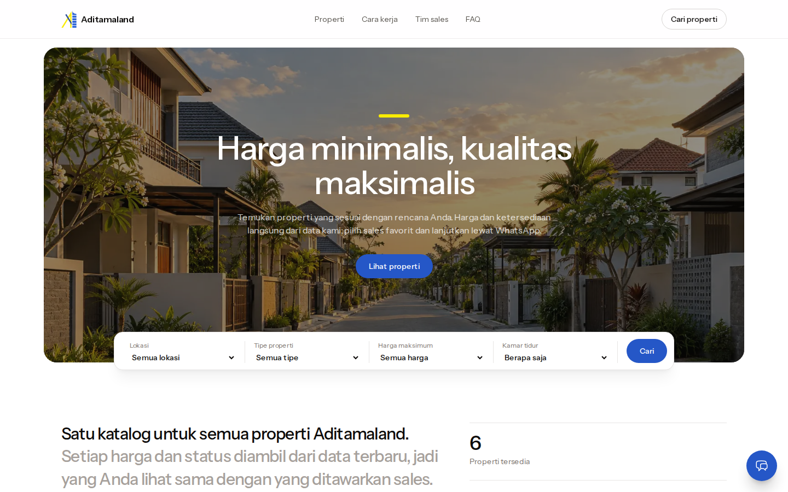

## Masalah dan solusi

Pembeli properti biasanya memperoleh info harga dan ketersediaan dari brosur atau chat yang cepat basi. Mereka harus menghitung cicilan sendiri dan tidak tahu harus menghubungi sales yang mana. Di sisi pengembang, inventaris, prospek, dan jadwal survei tersebar di spreadsheet dan WhatsApp pribadi.

Aditamaland Property menjawabnya dengan satu sumber data:

- **Untuk pembeli**
  - Katalog dengan filter lokasi, tipe, harga, luas, dan kamar.
  - Asisten AI yang mencari dan membandingkan listing langsung dari database.
  - Simulasi cicilan di halaman detail.
  - Tombol WhatsApp ke sales yang sudah disetujui admin.
- **Untuk tim internal**
  - Inventaris dengan foto, status publikasi/ketersediaan, dan riwayat status.
  - CRM prospek dengan tahap penjualan dan aktivitas.
  - Agenda kunjungan dan tindak lanjut.
  - Dashboard per peran.

## Tampilan

| Katalog dengan filter | Detail dan simulasi cicilan |
|---|---|
| 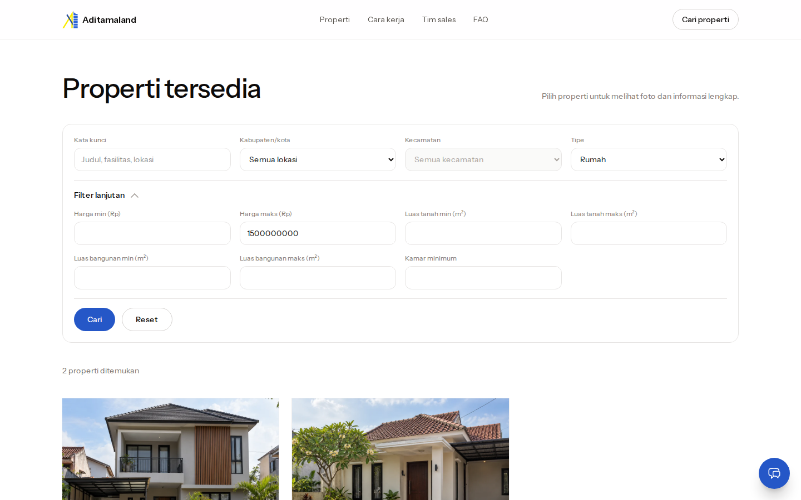 | 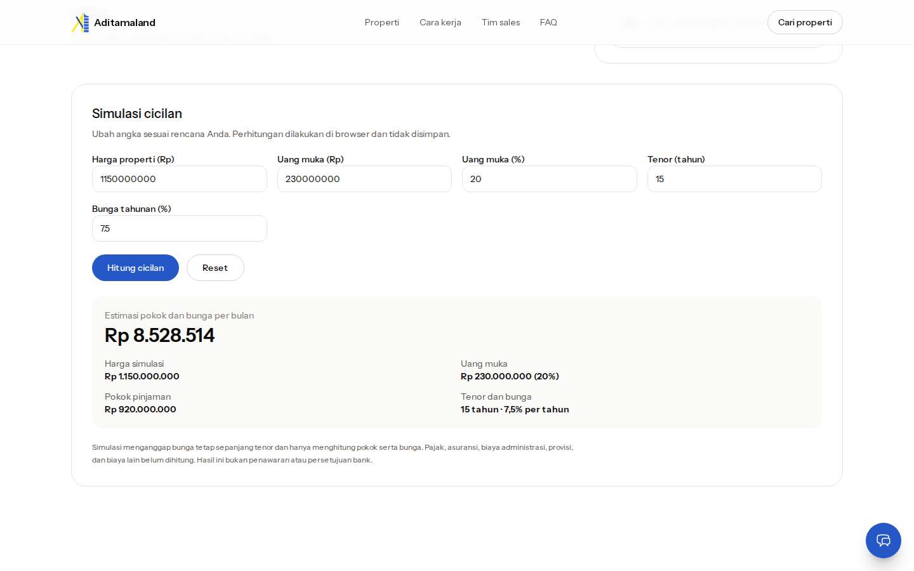 |
| **Asisten AI: pencarian** | **Asisten AI: perbandingan** |
| 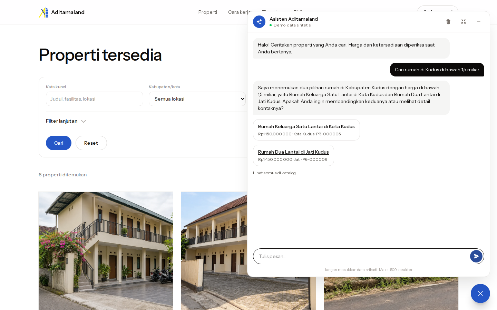 | 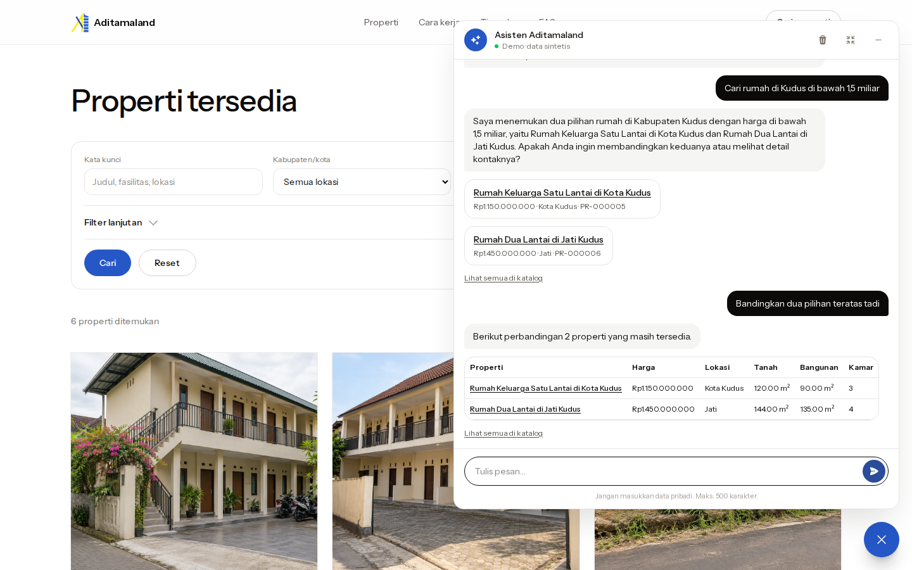 |
| **Properti terjual** | **Dashboard admin** |
| 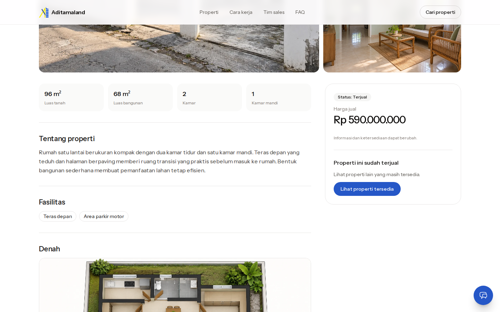 | 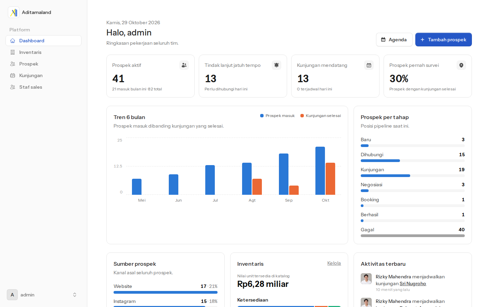 |
| **Dashboard sales** | **Inventaris** |
| 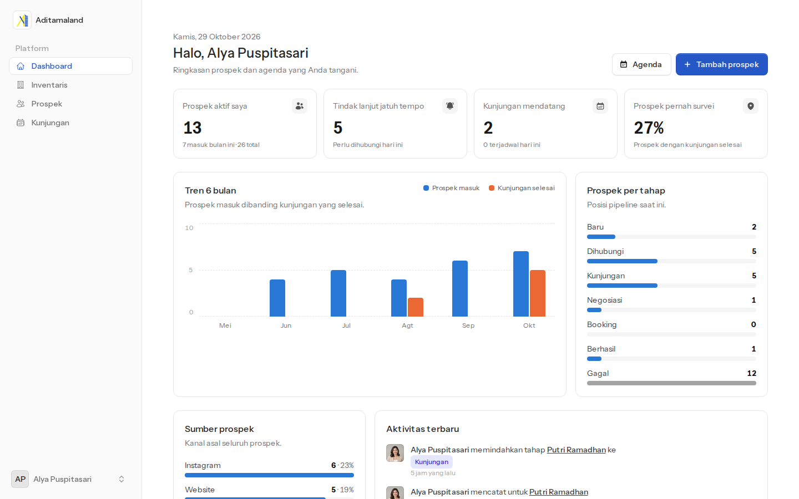 | 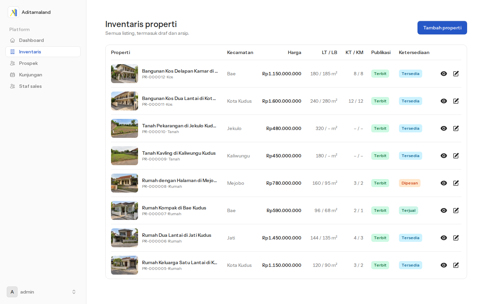 |
| **Riwayat status listing** | **Daftar prospek** |
| 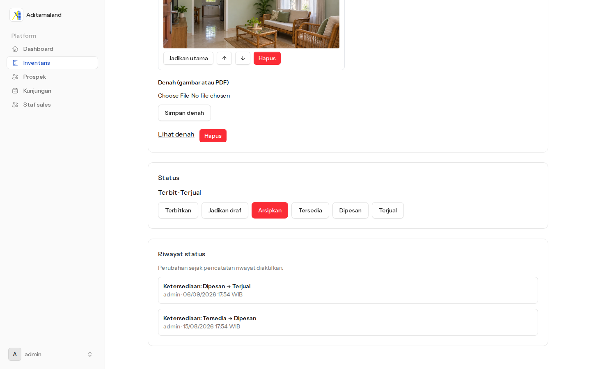 | 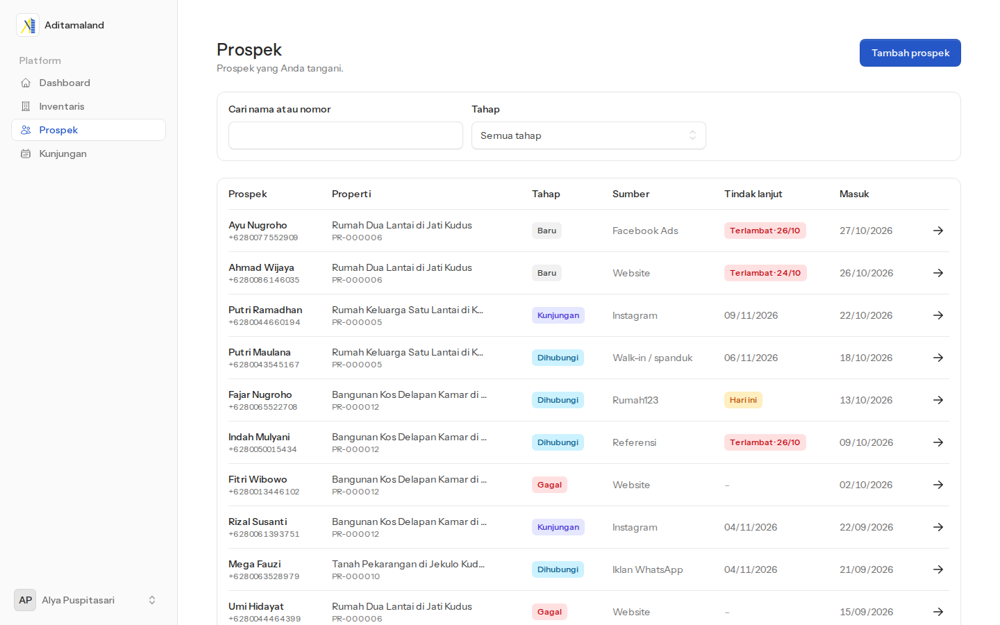 |
| **Detail prospek dan aktivitas** | **Kunjungan dan tindak lanjut** |
| 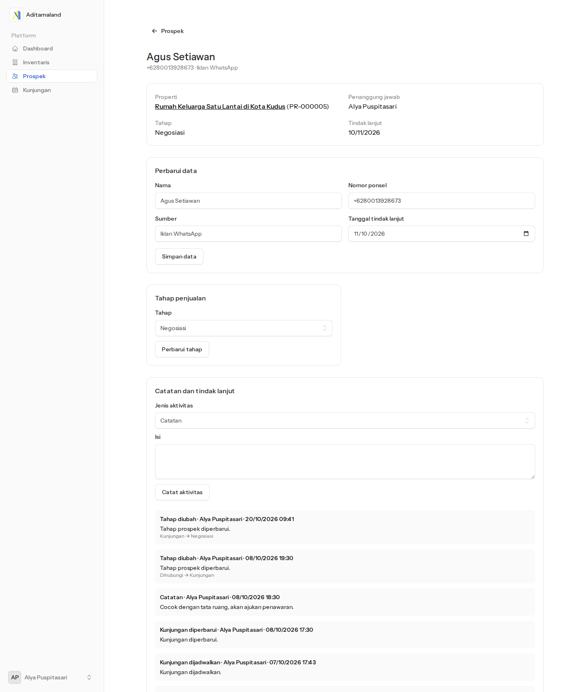 | 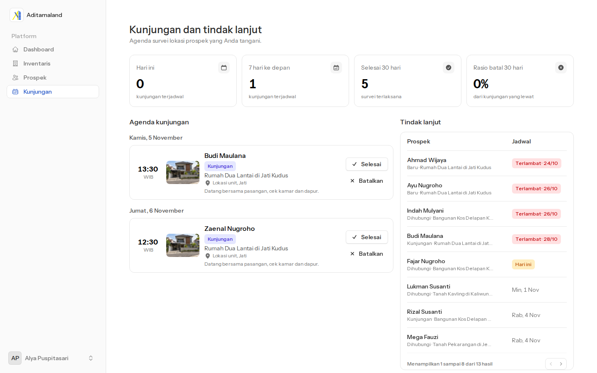 |
| **Staf sales** | **Tambah sales** |
| 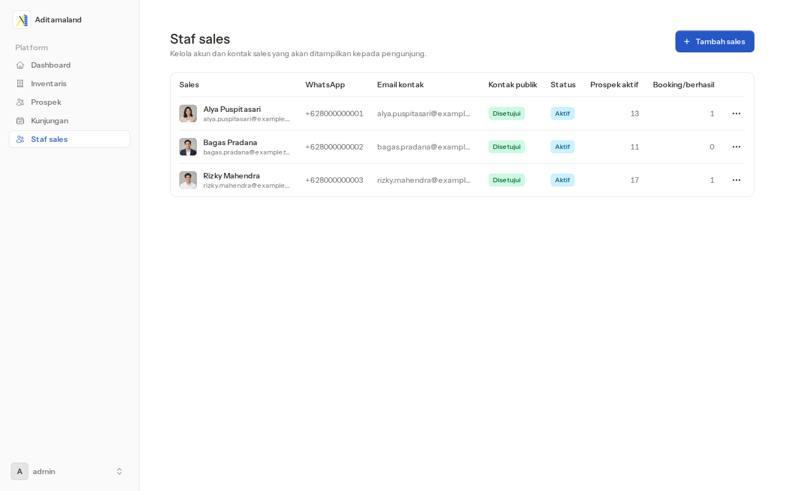 | 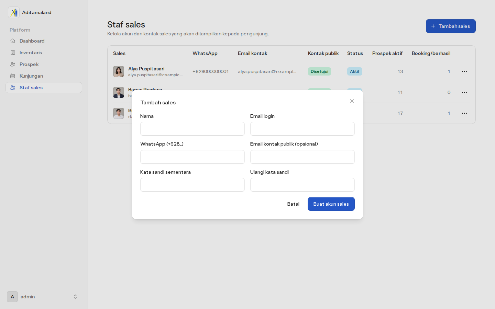 |

## Sorotan teknis

- **Asisten AI berbasis tool calling.** Model tidak mengarang data; jawabannya diambil dari tool pencarian, perbandingan, dan kontak sales yang membaca database. Guardrail menolak topik di luar properti, dan rate limit menjaga kuota.
- **Hak akses per peran.** Admin mengelola inventaris dan staf. Sales hanya melihat prospek dan kunjungannya sendiri.
- **Simulasi cicilan anuitas** dihitung di browser, dengan tes tersendiri.
- **Teruji:** tes fitur PHPUnit, analisis statis PHPStan, dan format kode Pint.

**Stack:** Laravel 13, Livewire 4 + Flux, Tailwind CSS 4, PostgreSQL 16, Cloudflare R2, Gemini (Laravel AI SDK).

## Menjalankan lokal

### Prasyarat

PHP 8.3+ dengan `pdo_pgsql`, Composer 2, Node/npm, dan Docker Compose. Bila binari Herd Lite dan NVM tidak ada di PATH shell:

```bash
export PATH="$HOME/.config/herd-lite/bin:$HOME/.nvm/versions/node/v24.22.1/bin:$PATH"
```

### Setup

```bash
docker compose up -d db
cp .env.example .env
composer install
php artisan key:generate
php artisan migrate
npm ci
npm run build
php artisan storage:link
php artisan serve
```

Aplikasi berjalan di `http://127.0.0.1:8000` dan database lokal di `127.0.0.1:55432`. Nilai di `compose.yaml` dan `.env.example` hanya untuk pengembangan lokal.

Pendaftaran publik dinonaktifkan. Buat admin pertama secara interaktif; kata sandi diminta tersembunyi:

```bash
php artisan users:create-admin
```

| Alamat | Isi | Akses |
|---|---|---|
| `/`, `/properti`, `/properti/{slug}` | Beranda, katalog, detail | Publik |
| `/dashboard` | Ringkasan per peran | Admin, sales |
| `/listings` | Inventaris, media, status, riwayat status | Admin kelola, sales baca |
| `/prospects`, `/visits` | Prospek, aktivitas, kunjungan | Sales miliknya, admin semua |
| `/staff` | Akun dan kontak sales | Admin |

### Data demo

Delapan listing sintetis Kudus (aset di `database/demo/kudus/`) membutuhkan `APP_ENV=local` dan `PROPERTY_MEDIA_DISK=r2`. `--check` memeriksa tanpa unggah; `--apply` aman diulang. Setelah aset sumber berubah, `--apply --replace` mengganti media kedelapan listing.

```bash
php artisan demo:import-kudus --check
```

```bash
php artisan demo:import-kudus --apply
```

Tiga akun sales sintetis (email `@example.test`, WhatsApp `+62800…`). Kata sandi development tertulis di `app/Console/Commands/SeedKudusSales.php`.

```bash
php artisan demo:seed-kudus-sales
```

Riwayat CRM sintetis: sekitar 80 prospek selama enam bulan, beserta aktivitas dan kunjungan. Tanggal dihitung relatif terhadap waktu seed, jadi segarkan dengan `--fresh` sebelum demo. Opsi ini mengganti semua prospek, aktivitas, kunjungan, dan riwayat status dalam satu transaksi.

```bash
php artisan demo:seed-crm --fresh
```

### Media Cloudflare R2

`PROPERTY_MEDIA_DISK=public` memakai disk lokal; `PROPERTY_MEDIA_DISK=r2` memakai R2. Isi `R2_ACCESS_KEY_ID`, `R2_SECRET_ACCESS_KEY`, `R2_BUCKET`, `R2_ENDPOINT`, dan `R2_PUBLIC_URL` di `.env`. Gunakan Access Key ID dan Secret dari token R2 berizin Object Read & Write, bukan token Cloudflare API. Lalu jalankan `php artisan config:clear` dan mulai ulang server. URL media pada custom domain bersifat publik.

Pratinjau objek yatim, lalu hapus hanya setelah hasilnya diperiksa:

```bash
php artisan listings:prune-media --disk=r2
```

```bash
php artisan listings:prune-media --disk=r2 --delete
```

Batas unggah aplikasi 10 MB per file. Naikkan batas PHP (`upload_max_filesize=16M`, `post_max_size=256M`) bila memakai bawaan 2 MB.

### Asisten AI

Widget chat muncul di halaman publik, khusus lingkungan lokal. Isi `GEMINI_API_KEY` dan `AI_ASSISTANT_ENABLED=true` di `.env`, jalankan `php artisan config:clear`, lalu mulai ulang server.

Batas aplikasi:
- 5 pesan global per menit;
- 10 pesan per IP per jam;
- 100 pesan global per hari (WIB).

### Tes

Buat database uji sekali setelah container PostgreSQL berjalan:

```bash
docker compose exec -T db psql -U real_estate -d real_estate -c 'CREATE DATABASE real_estate_test'
```

Pint, PHPStan, dan PHPUnit:

```bash
composer test
```

Tes kalkulator cicilan:

```bash
npm run test:calc
```
